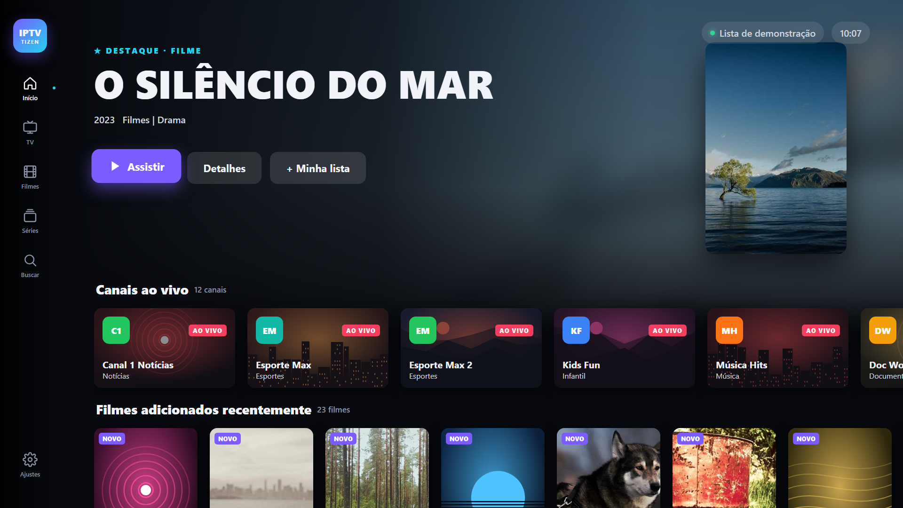
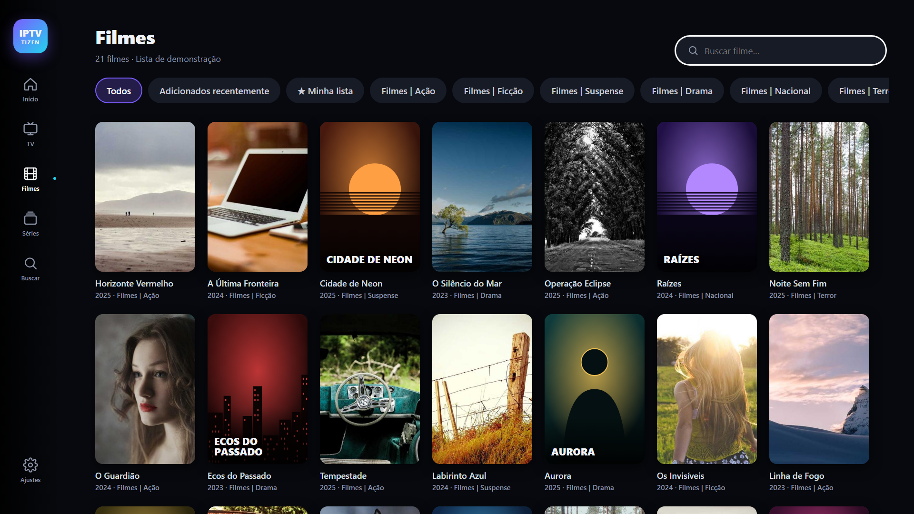
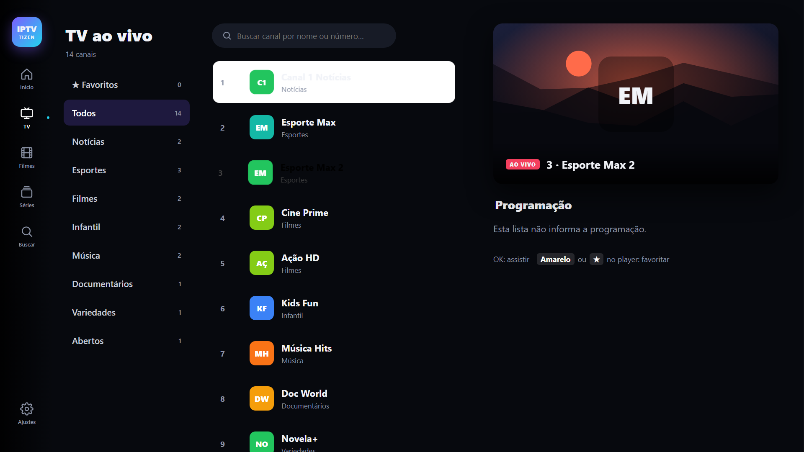
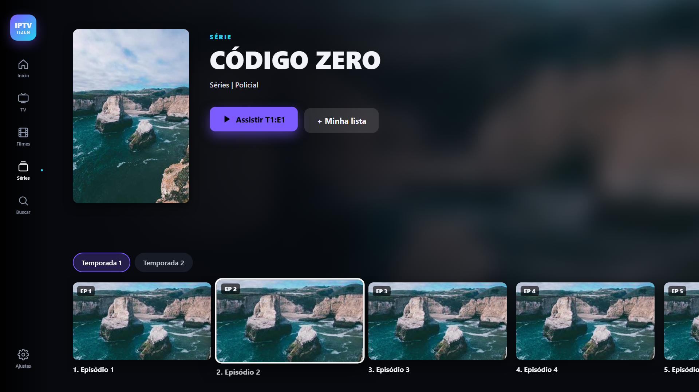
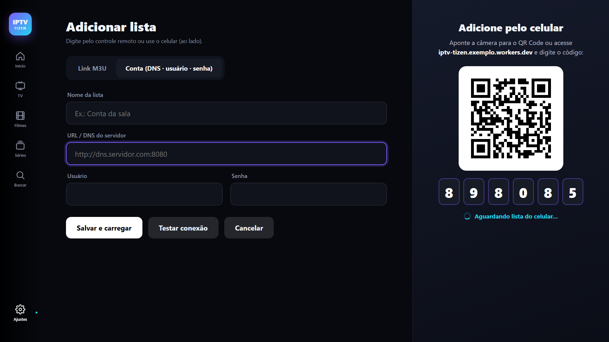

# IPTV TIZEN

Player de listas **M3U** e contas **Xtream Codes** (DNS, usuário e senha) para **TVs Samsung com Tizen**.

É um app web leve, sem bibliotecas externas, com navegação pelo controle remoto e foco nas capas dos títulos. Também dá para adicionar listas pelo celular usando um QR Code.

> ⚠️ O app **não fornece nenhum conteúdo**. Ele só reproduz as listas que o próprio usuário adiciona. Use apenas listas e serviços que você tem direito de acessar.



| Filmes | TV ao vivo |
|---|---|
|  |  |
| **Série** | **Adicionar lista (com QR Code)** |
|  |  |

*(Os prints usam uma lista de demonstração com títulos fictícios.)*

---

## Recursos
- **Listas:** M3U (link) e contas Xtream (DNS, usuário e senha).
  - Você pode ter várias listas salvas e ativar, recarregar, editar ou excluir cada uma.
  - Um link `get.php?username=…&password=…` vira **conta Xtream automaticamente**. Assim o app traz capas, sinopses, temporadas e programação.
- **Capas em primeiro lugar.** A ordem de busca é:
  1. a capa que vem na lista (`tvg-logo` no M3U, `stream_icon` ou `cover` no Xtream);
  2. a capa do **TMDB**, se você configurar uma chave;
  3. uma **capa automática** (arte em SVG com o nome do título), usada quando a imagem falta ou não carrega.
- **TV ao vivo:**
  - categorias, busca por nome ou número e favoritos (tecla amarela);
  - programação atual e próxima (Xtream);
  - troca de canal com ▲▼, CH+/CH− ou digitando o número.
- **Filmes e Séries:**
  - grade de capas, filtros por categoria, "Adicionados recentemente" e "Minha lista";
  - detalhes com sinopse, elenco e fundo (backdrop);
  - temporadas e episódios, com o próximo episódio tocando sozinho.
- **Continuar assistindo:** o app lembra a posição de filmes e episódios.
- **Player:**
  - usa o **AVPlay** da Samsung, que toca TS, HLS, MP4, MKV e outros;
  - troca de áudio e legenda e avança ou volta o vídeo.
- **Adicionar lista pelo celular:** a TV mostra um QR Code e um código de 6 dígitos. O celular envia a lista por um *relay* gratuito na Cloudflare.
- **Cache local:** a lista fica guardada no IndexedDB e só é baixada de novo depois de 12 h ou quando você pede.

## Compatibilidade
- TVs Samsung com **Tizen 4.0 ou mais novo** (modelos de 2018 em diante).
- Testado em um **QN55Q60R (2019, Tizen 5.0)**.
- O CSS e o JS evitam recursos que o Chromium 56 não suporta: sem CSS Grid, sem `gap` em flex, sem `aspect-ratio`, sem `inset`, sem `?.` e sem `??`.

---

## Estrutura

```
IPTV-TIZEN/
├── config.xml              # manifesto do app Tizen (id, privilégios, ícone)
├── index.html              # casca do app (carrega css/ e js/)
├── icon.png                # ícone 512x423
├── css/app.css             # visual (layout fixo 1920x1080, escalado para a tela)
├── js/
│   ├── config.js           # configurações públicas (relay e TMDB vazios)
│   ├── config.local.js     # SUAS configurações (não vai para o Git) — veja o .example
│   ├── art.js              # gerador de capas automáticas (SVG)
│   ├── qr.js               # gerador de QR Code próprio (sem dependências)
│   ├── data.js             # Store (localStorage + IndexedDB), leitor de M3U, API Xtream, TMDB
│   ├── player.js           # AVPlay (TV) / <video> HTML5 (PC)
│   └── app.js              # telas, navegação espacial, controle remoto
├── relay/worker.js         # Cloudflare Worker: página do celular + API do código
├── teste-pc/               # versão de demonstração para testar no navegador do PC
├── docs/                   # prints
└── instalar-na-tv.ps1      # empacota, assina e instala na TV pela rede
```

---

## Instalação na TV (passo a passo)

### 1. Instalar o Tizen Studio no PC (uma vez)
1. Baixe o instalador oficial. O link está na página da Samsung *Installing TV SDK* e aponta para `download.tizen.org/sdk/Installer/`.
   - Use o **`web-ide_Tizen_Studio_<versão>_windows-64.exe`**. A versão `web-cli` não traz o Certificate Manager, que é obrigatório.
   - Confira se o arquivo é assinado: botão direito → Propriedades → Assinaturas digitais → *Samsung Electronics Co., Ltd.*
2. Instale em **`C:\tizen-studio`** (pasta padrão). No final, deixe marcado *Launch the Package Manager*.
3. No **Package Manager**, abra a aba **Extension SDK** e instale:
   - **TV Extensions** (a mais nova);
   - **Samsung Certificate Extension**. Ela aparece instalada como `cert-add-on`.

### 2. Ativar o Modo Desenvolvedor na TV
1. No PC, rode `ipconfig` e anote o **IPv4** (ex.: `192.168.0.10`).
2. Na TV, abra **Apps** e digite **1 2 3 4 5** no controle.
3. Ligue **Developer mode: ON**, coloque o **IP do PC** em *Host PC IP* e confirme.
4. **Tire a TV da tomada por uns 10 segundos.** Desligar pelo controle não ativa o modo.
5. Anote o IP da TV: Configurações → Geral → Rede → Status da rede → Configurações de IP.

### 3. Conectar o PC à TV
```bash
C:\tizen-studio\tools\sdb.exe connect IP_DA_TV
```
```bash
C:\tizen-studio\tools\sdb.exe devices
```
O segundo comando deve listar algo como `IP:26101  device  QN55Q60RAGXZD`. O último campo é o **nome do dispositivo**, que vai ser usado nos próximos comandos.

Para ver o **DUID** da TV (é pedido no certificado):
```bash
C:\tizen-studio\tools\sdb.exe -s IP_DA_TV:26101 shell 0 getduid
```

### 4. Criar o certificado Samsung (uma vez)
Faça isso com a TV **já conectada** (passo 3). Assim o DUID entra sozinho no certificado.
1. Abra o **Tizen Studio** (`C:\tizen-studio\ide\TizenStudio.exe`) e vá em **Tools → Certificate Manager → +**.
2. Escolha **Samsung**, depois **TV**. Dê ao perfil o nome **`IPTVTIZEN`**.
3. Escolha **Create a new author certificate**. Preencha nome, senha e chave e faça login com a **conta Samsung** no navegador.
4. Escolha **Create a new distributor certificate**, com **Privilege: Public**, e confira se o DUID da TV está na lista. Clique em **Finish**.
5. O perfil `IPTVTIZEN` deve ficar **ativo**. Os arquivos ficam em `%USERPROFILE%\SamsungCertificate\IPTVTIZEN\`. **Nunca publique esses arquivos.**

### 5. Empacotar e instalar
O jeito fácil é rodar o script, que faz tudo sozinho:
```bash
powershell -ExecutionPolicy Bypass -File instalar-na-tv.ps1 -TV IP_DA_TV
```
O script:
1. copia só os arquivos do app para uma pasta temporária, sem README, relay, docs e testes;
2. conecta à TV;
3. assina o pacote com o perfil `IPTVTIZEN`;
4. **renomeia o `.wgt` para um nome sem espaço**;
5. instala o app e abre na TV.

Se preferir fazer à mão, rode os comandos abaixo trocando `PASTA` pela pasta de build.

Empacotar:
```bash
C:\tizen-studio\tools\ide\bin\tizen.bat package -t wgt -s IPTVTIZEN -- PASTA
```
Renomear o pacote para um nome sem espaço:
```bash
ren "PASTA\IPTV TIZEN.wgt" IPTVTIZEN.wgt
```
Instalar na TV:
```bash
C:\tizen-studio\tools\ide\bin\tizen.bat install -n IPTVTIZEN.wgt -t NOME_DO_DISPOSITIVO -- PASTA
```
Abrir o app:
```bash
C:\tizen-studio\tools\ide\bin\tizen.bat run -p IptvTizen1.IPTVTizen -t NOME_DO_DISPOSITIVO
```

---

## Problemas conhecidos e soluções (aprendidos na prática)

| Sintoma | Causa | Solução |
|---|---|---|
| `failed to connect to IP:26101`, mesmo com a porta aberta | A TV só aceita o PC cujo IP está em *Host PC IP*, e o modo só vale depois de reiniciar a TV pela tomada | Confira o IP do PC na TV (1 2 3 4 5 em Apps) e tire a TV da tomada por 10 s |
| `Failed to install Tizen application.` sem detalhes | O pacote gerado se chama `IPTV TIZEN.wgt`, **com espaço**, e a TV recusa o arquivo | Renomeie para `IPTVTIZEN.wgt` antes do `install` (o script já faz isso) |
| `There is no connected target` | O `tizen.bat` não aceita `-s IP:porta` | Use **`-t NOME_DO_DISPOSITIVO`** (o nome que o `sdb devices` mostra) |
| O app some ou não abre semanas depois | O certificado de desenvolvedor expirou | Rode o `instalar-na-tv.ps1` de novo. Se não resolver, recrie o certificado |
| Erro de assinatura ao instalar em outra TV | O DUID dessa TV não está no certificado de distribuidor | Recrie o distribuidor no Certificate Manager com a TV nova conectada |
| A TV mudou de IP | O roteador entrega o IP por DHCP | Rode o script com `-TV NOVO_IP`. Para não mudar mais, fixe o IP da TV no roteador |

---

## Adicionar lista pelo celular (relay grátis na Cloudflare)
1. Crie uma conta em **dash.cloudflare.com** (plano Free, sem cartão).
2. Vá em **Storage & Databases → Workers KV → Create** e crie um namespace chamado `iptv-tizen-lists`.
3. Vá em **Workers & Pages → Create → Start with Hello World!**, dê o nome `iptv-tizen` e clique em **Deploy**.
4. Clique em **Edit code**, cole todo o conteúdo de [`relay/worker.js`](relay/worker.js) e clique em **Deploy**.
5. No Worker, abra **Bindings → Add binding → KV namespace**. Use o nome de variável **`LISTS`** e escolha o namespace `iptv-tizen-lists`. Faça o deploy de novo.
6. Copie o endereço do Worker (`https://iptv-tizen.SEU-USUARIO.workers.dev`) e use **uma** destas opções:
   - copie `js/config.local.example.js` para `js/config.local.js`, preencha o endereço e reinstale o app;
   - ou, na TV, vá em **Ajustes → Celular** e cole o endereço.

Para testar o relay pelo PowerShell (troque `URL` pelo endereço do seu Worker):
```bash
Invoke-RestMethod URL/api/send -Method Post -ContentType application/json -Body '{"code":"999111","list":{"type":"m3u","name":"Teste","url":"http://teste.invalid/x.m3u"}}'
```
```bash
Invoke-RestMethod URL/api/get?code=999111
```
O primeiro comando deve responder `ok:true`. O segundo devolve a lista. Se você rodar o segundo de novo, ele responde `ok:false`, porque a lista é apagada assim que é lida.

**Como funciona:**
- A TV gera um código de 6 dígitos e mostra um QR Code com `RELAY/?c=CÓDIGO`.
- A cada 3 s, a TV consulta `GET /api/get?code=…`.
- O celular envia `POST /api/send`.
- A lista fica guardada por no máximo **15 minutos** e é **apagada assim que a TV lê**.

## Capas do TMDB (opcional)
Crie uma chave **v3** grátis em themoviedb.org (Configurações → API) e cole na TV em **Ajustes → Capas**. Outra opção é colocar a chave em `config.local.js`. O app só usa o TMDB para títulos que vieram **sem capa**, e guarda os resultados em cache.

---

## Testar no PC (sem TV)
Abra no Chrome ou no Edge, digitando o caminho com o `?demo` no final:
```
file:///C:/caminho/IPTV-TIZEN/teste-pc/index.html?demo
```
Esse modo carrega uma lista fictícia (`teste-pc/demo.js`). Use as setas, o Enter e o Backspace como se fossem o controle remoto. Para abrir direto em uma tela, use estes finais de endereço: `#live`, `#grid:movies`, `#grid:series`, `#movie`, `#serie`, `#settings:0`, `#listform:xtream`.

No PC, os vídeos não tocam: o formato TS/MKV só funciona no AVPlay da TV. O resto do app pode ser conferido normalmente.

Para tirar um print em 1920x1080 sem abrir janela, com o Chrome em modo headless (troque `CAMINHO` pela pasta do projeto, com `/`):
```bash
"C:\Program Files\Google\Chrome\Application\chrome.exe" --headless=new --hide-scrollbars --window-size=1920,1080 --virtual-time-budget=5000 --screenshot=tela.png "file:///CAMINHO/teste-pc/index.html?demo#home"
```

---

## Detalhes técnicos

### Como o M3U é classificado
| Regra | Vira |
|---|---|
| URL com `/movie/` | Filme |
| URL com `/series/` | Episódio de série |
| URL termina em `.mp4`, `.mkv`, `.avi`, `.mov` etc. e o nome tem `S01E02` | Episódio |
| URL termina em `.mp4`, `.mkv`, `.avi`, `.mov` etc., sem `SxxEyy` no nome | Filme |
| Qualquer outro caso (`.ts`, `.m3u8`, sem extensão) | Canal ao vivo |

Os episódios são agrupados em séries pelo nome antes do `SxxEyy`, junto com o `group-title`. O ano entre parênteses no fim do nome é separado e mostrado à parte.

### API Xtream usada
`player_api.php` com as ações:
- `get_live_categories`, `get_live_streams`
- `get_vod_categories`, `get_vod_streams`
- `get_series_categories`, `get_series`
- `get_vod_info`, `get_series_info`
- `get_short_epg`

As URLs de reprodução seguem estes formatos:
- `/live/USUÁRIO/SENHA/ID.m3u8` (ou `.ts`, se o servidor não permitir m3u8)
- `/movie/USUÁRIO/SENHA/ID.EXT`
- `/series/USUÁRIO/SENHA/ID_DO_EPISÓDIO.EXT`

### Dados salvos na TV
| Onde | O quê |
|---|---|
| `localStorage` | Listas (`it.lists`), lista ativa, favoritos por lista, progresso (até 40 itens), relay, chave e cache do TMDB |
| `IndexedDB` (`iptvtizen`) | O catálogo já processado de cada lista |

### Teclas do controle
| Tecla | Ação |
|---|---|
| Setas / OK | Navegar e abrir |
| Voltar | Volta uma tela. Na tela Início, pergunta se quer sair |
| Amarelo | Favoritar o canal ou o título selecionado |
| Ao vivo: ▲▼, CH+/CH−, números | Trocar de canal |
| Filme/série: ◀ ▶ | Voltar ou avançar 10 s |
| Play/Pause, ⏪ ⏩, Stop | Controles de mídia |

### Identificação do app
- `config.xml` → `package="IptvTizen1"`, `id="IptvTizen1.IPTVTizen"`.
- Privilégios: `internet`, `tv.inputdevice` e `network.public`.
- O acesso de rede está liberado para qualquer origem (`<access origin="*">`), porque cada lista vem de um servidor diferente.
